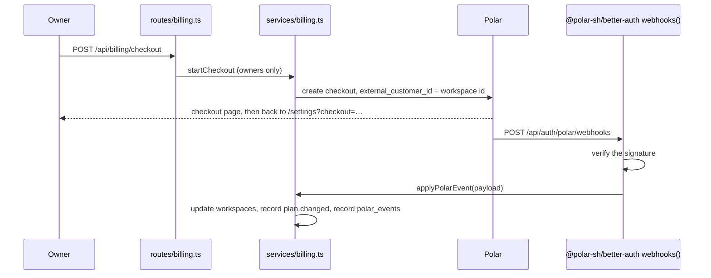

# Billing

A workspace is on Free or Team. Free sends 5 hollers a month, to any number of people. Team has no monthly limit and costs $12 a month or $120 a year per workspace. Polar sells Team as merchant of record, and a verified Polar webhook is the only thing that changes a workspace's plan. This page sets Polar up for a local or production Worker, then explains how a plan changes.

## Set up Polar

Use the sandbox at `sandbox.polar.sh` for local development and tests. Sandbox and production share nothing: products, tokens and webhook secrets are separate, so do every step once per environment.

1. Create a Polar organization for the Estonian OÜ, or open the existing one.
2. Create two recurring products with a fixed price: **Team monthly** at $12 a month and **Team yearly** at $120 a year. The prices live here and nowhere in the code. Copy both product ids. Checkout offers both, with monthly selected.
3. In **Settings › Developers**, create an organization access token with the `checkouts:write` and `customer_sessions:write` scopes.
4. In **Settings › Webhooks**, add an endpoint at `<PRODUCT_URL>/api/auth/polar/webhooks` with the **Raw** format. Subscribe to `subscription.created`, `subscription.updated`, `subscription.active`, `subscription.canceled`, `subscription.uncanceled`, `subscription.past_due` and `subscription.revoked`. Copy the secret.
5. Put the five values in `apps/web/.dev.vars` locally, or in `wrangler secret put` for production:

```bash
POLAR_SERVER=sandbox            # production in production
POLAR_ACCESS_TOKEN=polar_oat_…
POLAR_WEBHOOK_SECRET=…
POLAR_TEAM_MONTHLY_PRODUCT_ID=…
POLAR_TEAM_YEARLY_PRODUCT_ID=…
```

**Billing stays off until the token, the secret and the monthly product id are all set.** The yearly product is optional. Without them the webhook endpoint is not mounted, and **Upgrade to Team** says billing is not set up.

Polar cannot reach `localhost`. To receive sandbox webhooks locally, expose the dev server and point the sandbox endpoint at the tunnel:

```bash
cloudflared tunnel --url http://localhost:5280
```

Pay in the sandbox checkout with Stripe's test card `4242 4242 4242 4242`.

## How a plan changes

The Polar customer is the workspace, not the person who paid. Checkout passes the workspace id as Polar's `external_customer_id`, so every owner opens the same customer portal and sees the same subscription, whoever started it.



`applyPolarEvent` in `services/billing.ts` reads each `subscription.*` event and sets `plan`, `polar_customer_id`, `polar_subscription_id` and `plan_ends_at` in one batch with a `plan.changed` Activity entry.

| Polar subscription | Workspace |
| --- | --- |
| `active`, `trialing` or `past_due` | Team. `plan_ends_at` is set when it is cancelled at the period end, and cleared when it renews. |
| `incomplete` | No change until the payment completes. |
| Anything else, such as `canceled` after `subscription.revoked` | Free, unless the workspace already moved to a newer subscription. |

Polar may repeat or reorder deliveries. `polar_events` keeps one row per event, keyed by type, subscription and `modified_at`. A repeat is a no-op, and an event older than one already applied for the same subscription is recorded as `stale` and skipped.

The plugin's own `checkout()` and `portal()` endpoints are not mounted. They bill the signed-in person, or a Better Auth organization, and Holler's workspaces are neither. `routes/billing.ts` does the same two calls with the workspace as the customer and checks that the caller is an owner.

## Where billing shows

`PlanSection` in `components/billing/plan-section.tsx` is the Billing section of the one Settings page, at `/settings#billing`. It loads its own data and takes no props. Every member sees the plan and this month's sends; owners get **Upgrade to Team** and **Manage billing**. Its states are on `/design` in local development.

## Where the limit shows

`packages/core/src/plans.ts` holds the Free limit, and `services/usage.ts` enforces it at send with `assertCanSend`, which throws `limit_reached` (HTTP `402`). Every door that sends gets the same error. In the web app, show `LimitReached` from `components/billing/limit-reached.tsx` beside **Send** when a send returns `402`:

```tsx
{sendError?.code === "limit_reached" && <LimitReached fallbackMessage={sendError.message} />}
```

It reads `GET /api/billing`, offers owners **Upgrade to Team**, and tells senders which owner to ask.
