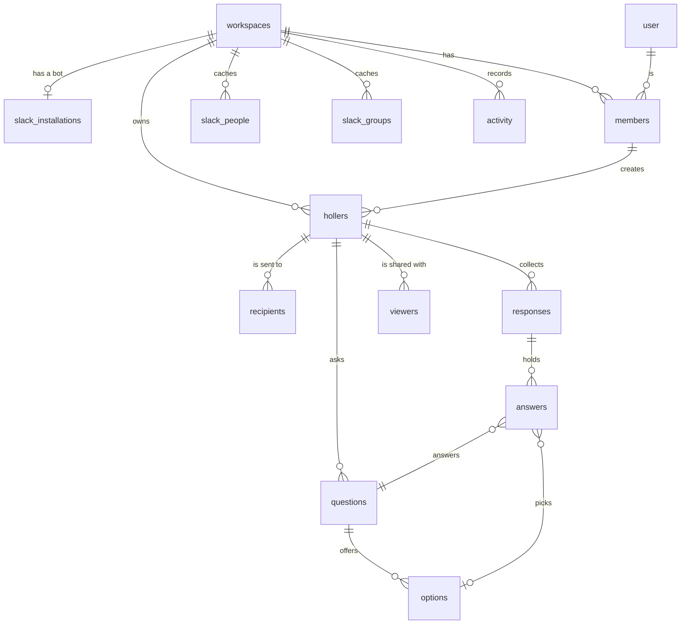
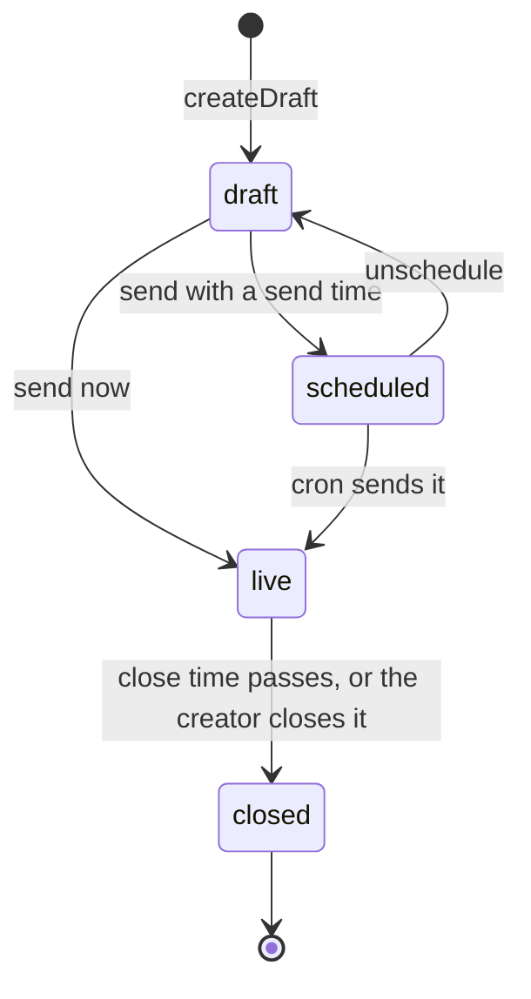

# Data model

The schema is in `packages/core/src/schema`. This page explains the shape and the rules the schema cannot say by itself. Every product table carries `workspace_id`, and every service query filters by the context's workspace.

## Tables

| Table                                                     | One row is                                  | Notes                                                                       |
| --------------------------------------------------------- | ------------------------------------------- | --------------------------------------------------------------------------- |
| `workspaces`                                              | A Slack workspace that installed Holler     | Keyed by `slack_team_id`. Holds the plan; only the Polar webhook changes it |
| `slack_installations`                                     | The workspace's bot                         | The token is AES-GCM ciphertext. A reinstall replaces the row               |
| `members`                                                 | A person signed in to Holler in a workspace | Links a Better Auth `user` to a Slack user id. `owner` or `sender`          |
| `slack_people`, `slack_groups`                            | Holler's copy of the Slack directory        | For the picker and names. `search_name` is folded in JavaScript             |
| `directory_syncs`                                         | Where each workspace's directory sync stands | Slack's cursor between steps, so a big workspace syncs over several cron runs |
| `hollers`                                                 | One Holler, from draft to closed            | A draft is a Holler with status `draft`                                     |
| `questions`, `options`                                    | What a Holler asks                          | Replaced wholesale while a draft; frozen once sent                          |
| `recipients`                                              | One person a Holler went to                 | The completion ledger: invited, answered, reminders, the DM to update       |
| `responses`, `answers`                                    | One person's answers                        | No person on an anonymous Holler                                            |
| `viewers`                                                 | A member a Holler's results are shared with |                                                                             |
| `activity`                                                | One write                                   | The only writer is `services/audit.ts`                                      |
| `slack_deliveries`                                        | A Slack event or view already handled       | Drops Slack's retries                                                       |
| `user`, `session`, `account`, `apikey`, `jwks`, `oauth_*` | Better Auth                                 | Generated: `pnpm --filter @holler/web auth:schema`. Never edit by hand      |

## Lifecycle

Sending is the moment a Holler counts against the monthly limit (`hollers.sent_at`), resolves its audience into `recipients`, and freezes its questions.

## Rules

**Anonymity.** For an anonymous Holler, `responses.slack_user_id` is null and `responses.submitted_at` and `recipients.answered_at` are rounded down to the hour. `recipients.answered_at` is how Holler knows who answered without knowing what they said. Results open only at five responses (`anonymousThreshold` in `packages/core/src/results.ts`), and the same gate applies to the web app, the API, MCP, exports and Slack.

**One response per person.** The answer path claims `recipients.answered_at` with a guarded update before it writes the response, so two submits at once produce one response. On a named Holler the partial unique index `responses_one_per_person` backs it up.

**An option answers only its own question.** `answers (question_id, option_id)` is a foreign key to `options (question_id, id)`, and a check makes each answer either an option or text, never both.

**Case folding.** SQLite's `lower()` folds ASCII only, so Дієслова and дієслова would differ. Text that is searched is stored folded with `toLocaleLowerCase()` in a `search_*` column. Biome refuses `lower(` in server SQL.

**D1 binds at most 100 values in one statement.** Insert rows one per statement inside a batch, never a multi-row `values([...])` that can grow with input. `runBatch` in `apps/web/src/server/batch.ts` takes a list.

**Migrations.** Generate with `pnpm db:generate`, then record with `node scripts/check-migrations.mjs --write`. An applied migration never changes; `pnpm check:migrations` fails if one does.
