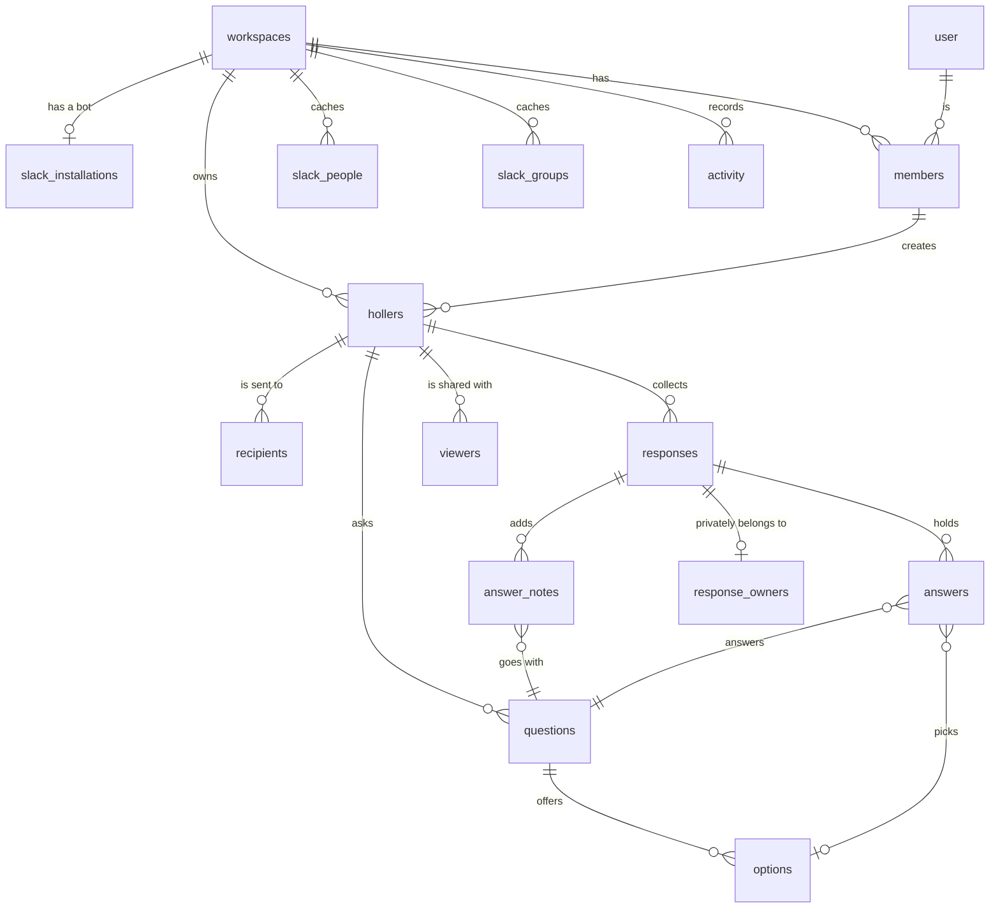
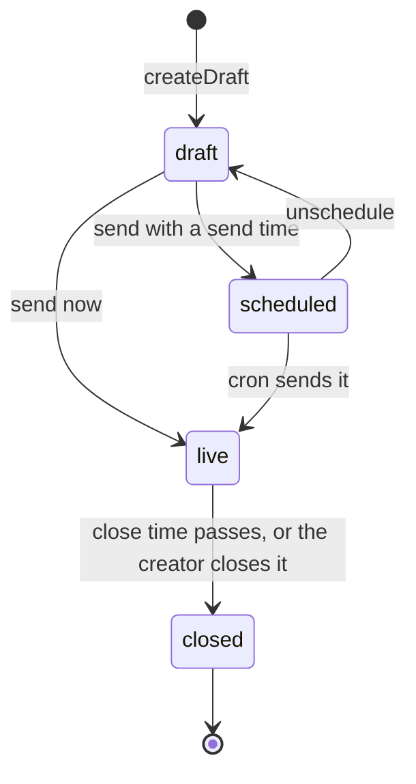

# Data model

The schema is in `packages/core/src/schema`. This page explains the shape and the rules the schema cannot say by itself. Every top-level product table carries `workspace_id`. The tables that hang off a Holler (`questions`, `options`, `recipients`, `viewers`, `responses`, `response_owners`, `answers` and `answer_notes`) do not: they are scoped through `holler_id`, so a service reaches them only after it has loaded the Holler filtered by the context's workspace.

## Tables

| Table                                                     | One row is                                  | Notes                                                                       |
| --------------------------------------------------------- | ------------------------------------------- | --------------------------------------------------------------------------- |
| `workspaces`                                              | A Slack workspace that installed Holler     | Keyed by `slack_team_id`. Holds the plan; only the Polar webhook changes it |
| `slack_installations`                                     | The workspace's bot                         | The token is AES-GCM ciphertext. A reinstall replaces the row               |
| `members`                                                 | A person signed in to Holler in a workspace | Links a Better Auth `user` to a Slack user id. `owner` or `sender`          |
| `slack_people`, `slack_groups`                            | Holler's copy of the Slack directory        | For the picker and names. `search_name` is folded in JavaScript             |
| `directory_syncs`                                         | Where each workspace's directory sync stands | Slack's cursor between steps, so a big workspace syncs over several cron runs |
| `hollers`                                                 | One Holler, from draft to closed            | A draft is a Holler with status `draft`                                     |
| `questions`, `options`                                    | What a Holler asks                          | Synced by id while a draft or scheduled; frozen once sent. One option row per question may be Other (`is_other`), always last |
| `recipients`                                              | One person a Holler went to                 | The completion ledger: invited, answered, reminders, the DM to update       |
| `responses`, `answers`                                    | One person's answers                        | No person on an anonymous Holler                                            |
| `response_owners`                                         | The private link from an anonymous response to its person | Read only by `services/own-answers.ts`; ADR 0003                |
| `answer_notes`                                            | A follow-up note or an Other write-in       | Beside a choice answer, at most one of each kind per question per response  |
| `viewers`                                                 | A member a Holler's results are shared with |                                                                             |
| `activity`                                                | One change                                  | Written only by `services/audit.ts`, in the batch that makes the change     |
| `slack_deliveries`                                        | A Slack event or view already handled       | Drops Slack's retries                                                       |
| `slack_homes` | Someone who opened Holler's App Home, and whether a fresh one is queued | Pushes go only to people with a Home; `queued_at` turns a burst of changes into one publish |
| `user`, `session`, `account`, `apikey`, `jwks`, `oauth_*` | Better Auth                                 | Generated: `pnpm --filter @holler/web auth:schema`. Never edit by hand      |

## Lifecycle

Sending is the moment a Holler counts against the monthly limit (`hollers.sent_at`), resolves its audience into `recipients`, and freezes its questions.

## Rules

**Billing events.** `polar_events.id` makes a replayed delivery do nothing, and `occurred_at` lets a late, older event lose to a newer one already applied.

**Whose workspace.** A signed-in person acts in the workspace of their most recent Slack sign-in, or in their oldest membership when Slack gave none.

**Anonymity.** For an anonymous Holler, `responses.slack_user_id` is null and `responses.submitted_at` and `recipients.answered_at` are rounded down to the hour. `recipients.answered_at` is how reminders know who answered. `response_owners` links each anonymous response to its person, so Your answers can show them their own; only `services/own-answers.ts` reads it, and Oxlint's `holler/no-response-owners` refuses it anywhere else ([ADR 0003](adr/0003-anonymous-answers-stay-linked-to-their-person.md)). Results open only at five responses (`anonymousThreshold` in `packages/core/src/results.ts`), and the same gate applies to the web app, the API, MCP, exports and Slack. Written answers on an anonymous Holler come back sorted by what they say, not in arrival order, because arrival order could be matched to when someone was reminded or thanked (`summarize` in `packages/core/src/results.ts`).

**One response per person.** The answer path claims `recipients.answered_at` with a guarded update before it writes the response, so two submits at once produce one response. On a named Holler the partial unique index `responses_one_per_person` backs it up.

**An option answers only its own question.** `answers (question_id, option_id)` is a foreign key to `options (question_id, id)`, and a check makes each answer either an option or text, never both.

**What `answers.text` holds.** A free-text answer's words; a number answer's whole number as its decimal string, such as `"12"` or `"-3"`; a person answer's Slack user id, one `answers` row for each person picked. `recordResponse` checks a number against the question's `number_min` and `number_max`, and a person against `slack_people` for the workspace, before it writes.

**Other and follow-up notes.** A plain choice question with `allowOther` has exactly one option row with `is_other` true, labelled Other and placed after every option the sender wrote. The editor never sends it as an option: `syncQuestions` keeps its id across autosaves and deletes it when Other is turned off. What someone writes beside Other, and the follow-up note after a choice question, are `answer_notes` rows (`kind` is `other` or `note`), because an `answers` row holds an option or text, never both. A follow-up's `follow_up_when` lists option positions, with Other at the last position; null shows it after any answer.

**Repeating pulses.** `hollers.repeat_rule` is `week` or `fortnight`, and every later round's `repeat_of_id` names the first round, so a series is the first round and the rows that point at it. When a round goes live, `goLive` in `services/delivery.ts` schedules the next round as the send's last step (`nextRound` in `services/rounds.ts`): one batch writes the round as a draft, schedules it if the series still repeats and records that, and deletes it if not. When that step fails the send is undone and its Activity taken back. The next round's send time comes from `nextRoundAt` in `packages/core/src/repeats.ts`: the first round's wall-clock day and time in the creator's Slack time zone, plus whole weeks, and never earlier than now, so daylight saving never moves a round and a late send skips the rounds that already passed. The unique index `hollers_round` on `(repeat_of_id, send_at)` backs the exactly-once send claim. `roundColumns` names every `hollers` column as copied to the next round or set for each round, so a new column does not typecheck until someone decides which it is. A round that fails to send goes back to draft like any scheduled Holler, which ends the series until its creator sends it again.

**Mode.** The mode may change while a Holler is a draft or scheduled. A chase has no questions, so saving a draft as a chase deletes its questions.

**Case folding.** SQLite's `lower()` folds ASCII only, so Дієслова and дієслова would differ. Text that is searched is stored folded with `toLocaleLowerCase()` in a `search_*` column. Oxlint (`holler/no-sql-lower`) refuses `lower(` in server SQL.

**D1 binds at most 100 values in one statement.** Insert rows one per statement inside a batch, never a multi-row `values([...])` that can grow with input. `runBatch` in `apps/web/src/server/batch.ts` takes a list.

**Migrations.** Generate with `pnpm db:generate`, then record with `node scripts/check-migrations.mjs --write`. An applied migration never changes; `pnpm check:migrations` fails if one does.
