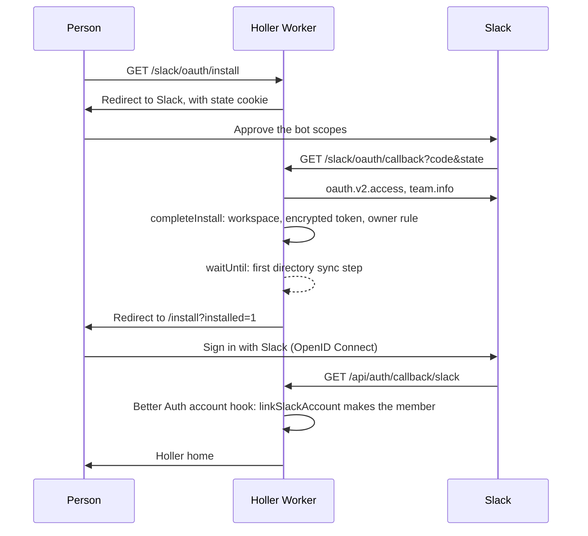
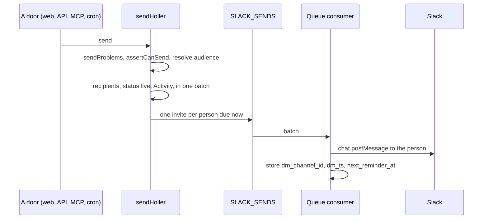

# Slack

Slack is where Holler lives day to day. The person answering should never need the web app, and a sender should be able to do the common things without leaving Slack. This file is the design for every Slack surface. The words follow [CONTEXT.md](../CONTEXT.md) and the voice rules in [DESIGN.md](../DESIGN.md).

## The app

One Slack app, distributed through OAuth to any workspace. Bot scopes:

| Scope                            | Why                                                       |
| -------------------------------- | --------------------------------------------------------- |
| `chat:write`                     | DMs, reminders, thank-yous, announcements                 |
| `im:write`                       | Open the DM with a recipient                              |
| `users:read`, `users:read.email` | The audience picker, names, avatars, time zones           |
| `usergroups:read`                | Send to a user group                                      |
| `channels:read`, `groups:read`   | Send to a channel's members, pick an announcement channel |
| `team:read`                      | The workspace's name, subdomain and icon in Settings      |
| `commands`                       | `/holler`                                                 |
| `app_mentions:read`              | Not used in the first version                             |

User sign-in is "Sign in with Slack" (OpenID Connect, scopes `openid profile email`), handled by Better Auth. Installing ("Add to Slack") and signing in are two flows; the install page runs the second straight after the first.

Endpoints, all on the product Worker. Slack signs every request it sends, and each handler checks it with `verifySlackRequest` before anything reads the body. The two OAuth paths are browser redirects that Slack does not sign; a one-time state cookie proves the install started on Holler.

| Path                    | Slack sends                                                                                    |
| ----------------------- | ---------------------------------------------------------------------------------------------- |
| `/slack/oauth/install`  | Nothing. "Add to Slack" starts here and redirects to Slack with the bot scopes and a state     |
| `/slack/oauth/callback` | The install redirect. Stores the bot token encrypted (`encryptToken`)                          |
| `/slack/events`         | Events API: `app_home_opened`, `app_uninstalled`, `tokens_revoked`, `user_change`, `team_join` |
| `/slack/interactions`   | Buttons, modals, shortcuts                                                                     |
| `/slack/commands`       | `/holler`                                                                                      |

Every handler acknowledges within three seconds. Anything slower runs in `waitUntil` or goes on the `SLACK_SENDS` queue. Retries are dropped by recording Slack's event or view id in `slack_deliveries`. Every Slack call goes through `SlackClient` in `apps/web/src/server/slack/client.ts`; tests use `FakeSlack`.

## Installing and signing in

"Add to Slack" and "Sign in with Slack" are two OAuth flows, and the install page runs the second straight after the first, so they feel like one step.

- **The workspace.** `completeInstall` in `services/workspaces.ts` creates or updates the `workspaces` row from the team id, stores the bot in `slack_installations` with `encryptToken`, and clears `uninstalled_at`. A reinstall replaces the bot.
- **The member.** Better Auth stores the Slack ID token on every sign-in, and its account hooks call `linkSlackAccount`. The token's `https://slack.com/team_id` claim names the workspace. Sign-in is open, so everyone in an installed workspace becomes a sender.
- **Owners.** The installer becomes an owner when the workspace has no owner, on their first sign-in or at once if they signed in before. A reinstaller becomes an owner only when no owner is left. Owners make other members owners or senders in Settings; the last owner stays one.
- **No install yet.** Someone who signs in to a workspace without Holler has no member row, and `/install` offers **Add to Slack**. If the workspace needs an admin to approve apps, Slack sends the admin a request instead of installing.
- **Enterprise Grid.** An install that reports an enterprise is refused and its token revoked, and a Grid sign-in gets no member.
- **Uninstall.** `app_uninstalled`, or `tokens_revoked` for the bot, sets `workspaces.uninstalled_at` and deletes the installation. Every page says sending is paused, and owners see **Add to Slack again**.

## Keeping the directory fresh

`services/directory-sync.ts` copies people from `users.list`, user groups from `usergroups.list`, and channels from `conversations.list` into `slack_people` and `slack_groups`. `conversations.list` returns public channels and the private channels the bot was added to. Names are folded for search in JavaScript into `search_name` by `foldForSearch` in `packages/core/src/search.ts`, because SQLite's `lower()` is ASCII only: lowercase, accents off, and hyphens, dots and underscores read as spaces. The audience picker's search (`services/directory.ts`) folds what was typed the same way, ranks a name's start above a match inside it, and puts the people and groups the sender sends to most first. Search reads only this copy, never Slack: `@` searches handles and `#` searches channels. A pasted list resolves each name, handle or email to the one person or group it names in whole words, so "ma" never quietly adds Marta. Each term runs its own search, so one term's matches never crowd out another's; a term that matches nobody, or several, comes back in `missed` in the order it was pasted.

A sync runs in steps of two pages, and `directory_syncs` keeps Slack's cursor between them. The install runs the first steps; the cron carries on every minute until the sync is done, then starts the next one a day later. A rate limit ends the step early with its place saved. `user_change` and `team_join` update one person as they happen. Groups and channels that Slack stops listing are removed when a sync finishes; people stay, marked deleted.

## How to create the Slack app

The app is defined in [`slack-app-manifest.json`](../slack-app-manifest.json) at the repo root. It sets the scopes, the redirect URLs, the event subscriptions, the interactivity URL and `/holler`.

1. Go to [api.slack.com/apps](https://api.slack.com/apps) and click **Create New App**, then **From a manifest**.
2. Pick a workspace to develop in, paste the manifest, and create the app.
3. For a local or staging app, replace `https://app.holler.team` with your own public URL everywhere in the manifest. Slack needs an HTTPS URL it can reach, so use a tunnel such as `cloudflared tunnel --url http://localhost:5280` locally, and set `PRODUCT_URL` in `.dev.vars` to the same URL.
4. Under **Basic Information**, copy the client id, the client secret and the signing secret into `.dev.vars` as `SLACK_CLIENT_ID`, `SLACK_CLIENT_SECRET` and `SLACK_SIGNING_SECRET`. In production, set them with `wrangler secret put`.
5. Under **Manage Distribution**, turn on public distribution so other workspaces can install it.
6. Open `/install` and click **Add to Slack**.

| Manifest setting  | Value                                                                                   |
| ----------------- | --------------------------------------------------------------------------------------- |
| Bot scopes        | `chat:write`, `im:write`, `users:read`, `users:read.email`, `usergroups:read`, `channels:read`, `groups:read`, `team:read`, `commands` |
| User scopes       | `openid`, `profile`, `email`, for Sign in with Slack                                     |
| Redirect URLs     | `/slack/oauth/callback` for the install, `/api/auth/callback/slack` for Better Auth     |
| Event request URL | `/slack/events`                                                                         |
| Bot events        | `app_home_opened`, `app_uninstalled`, `tokens_revoked`, `user_change`, `team_join`      |
| Interactivity URL | `/slack/interactions`                                                                   |
| Slash command     | `/holler`, at `/slack/commands`                                                         |

**Keep the bot scopes in the manifest and `BOT_SCOPES` in `apps/web/src/server/slack/oauth.ts` the same.** A scope added to one and not the other means a reinstall asks for something the code does not request, or the other way round.

## Sending

`sendHoller` in `services/delivery.ts` is the one way a Holler goes out, from every door. It refuses a draft with every problem from `sendProblems` at once, checks the monthly limit, and with a send time in the future only marks the Holler scheduled. Sending now resolves the audience into `recipients`, sets `sent_at` and `closes_at`, and puts one invite per person on the `SLACK_SENDS` queue.

- **Who gets it.** People picked by name, members of the picked user groups and channels, and everyone in the directory for the whole workspace. Bots and people who left are skipped. The sender gets it too when the audience includes them, like anyone else.
- **Send in their time zone.** The send time is a wall-clock time in the sender's zone, and each person gets it at that time in theirs. The Holler goes live when the earliest zone on Earth reaches it, and the cron invites each person as their time arrives. Someone whose time had already passed gets it at once. It closes `close_after_hours` after the last person's send.
- **At most once.** A recipient is claimed (`invited_at`) before their invite is queued, and the consumer posts only while `dm_ts` is empty, so a queue retry never sends twice.
- **Failures.** A permanent Slack error (`SlackApiError.permanent`) is stored in `recipients.failure` and not retried. A rate limit waits for `Retry-After`; any other error retries with backoff.
- **Claims and the queue.** Every pass claims its rows (`invited_at`, `reminders_sent`, `reminded_at`, `close_queued_at`) with a guarded update, then queues through `queueClaimed`. When the queue refuses a batch, the claims for it and every later batch are given back, so the next cron run retries them and nothing is lost or sent twice. A send or close the person asked for still succeeds; its Slack work follows within a minute.
- **Posts happen once.** `sendEffects` in `services/delivery.ts` says whether each kind of send posts a new message or edits one. Before posting, the consumer claims the send's `postKey` in `slack_deliveries`, so a send delivered twice, even at the same time, posts once; a failed post gives the claim back for the retry. Edits rewrite a message to the current state, so a repeat is harmless.
- **Close work and announcements catch up.** Close work is claimed one Holler at a time, so a queue failure leaves the rest for the next pass. An announcement that never posted is queued again by the cron from two minutes after the send, for a day.
- **Every DM edit goes through the queue**, so a rate limit retries it: thank-yous, closed lines, snoozed reminders.
- **Block Kit.** `FakeSlack` refuses any payload that breaks a limit in `slack/blocks/limits.ts`, the way Slack would. A description longer than one section is split across several; a label over 75 characters is cut with an ellipsis.

**Closing.** The close time passing, or **Close now**, closes the Holler. Each unanswered DM is edited in place to say it closed, with its buttons gone, the announcement shows its final count, and the sender gets the close notice.

**Send reminder.** A sender's reminder goes at once to everyone waiting, outside working hours too, and counts as each person's next reminder in the rhythm. It can be sent once every four hours; a second try inside that window is refused with when the next one is possible.

## Answering: as few taps as the question allows

The invite DM adapts to the Holler, so answering costs the least the question allows. `answerSurface` in `packages/core/src/surfaces.ts` decides which, and the editor says so before it is sent.

| The Holler                                                                                      | How it is answered                                                                                                |
| ----------------------------------------------------------------------------------------------- | ----------------------------------------------------------------------------------------------------------------- |
| A pulse with one single-choice question of at most 25 options and no Other                     | One tap on a button in the DM, then an optional note in the DM. No modal                                          |
| A pulse with one free-text question                                                             | A text box in the DM                                                                                              |
| A pulse or survey that fits a modal (at most 100 blocks, at most 100 options per question)      | **Answer** opens a modal                                                                                          |
| A follow-up shown only after some answers, a question over 100 options, or more than 100 blocks | **Answer** links to the web form at `/respond/<id>`, which identifies the person through a signed link in the DM |
| A chase                                                                                         | **Open the form** links out; **I submitted it** records the response                                              |

**Answering in the DM.** The buttons are one actions block. A tap records the answer at once through `recordResponse`, then the DM is updated in place: what they picked, and, when the question has a follow-up, the follow-up prompt over an input block holding a plain-text input with `dispatch_action: true` and `dispatch_action_config.trigger_actions_on: ["on_enter_pressed"]`. Pressing Enter sends a `block_actions` payload with the note, which is saved as the response's `note` row in `answer_notes`; an empty box saves nothing, and the note stays optional even when the question is required. A free-text pulse uses the same input block for the answer itself. Notes in the DM never use thread replies, which would need `im:history`.

The note box's block id carries the response id (`note:<response>:<question>`), so a note on an anonymous Holler finds its response without Holler storing who wrote it: the link lives only in the person's own DM. A named response takes a note only from its own person. A web-only Holler's **Answer** is the person's signed link from `services/respond-links.ts`; the form at `/respond/<id>` checks it.

**In a modal.** Each question is one input block, with the question's description as the block's `hint`, and `optional` set when the question is not required. Slack checks what it can; `recordResponse` checks everything again and its messages come back as `response_action: "errors"` keyed by block.

| Question                  | Element                                                                                                                                                      |
| ------------------------- | ------------------------------------------------------------------------------------------------------------------------------------------------------------ |
| Single choice             | `radio_buttons` up to 10 options, `static_select` above that                                                                                                 |
| Multiple choice           | `checkboxes` up to 10 options, `multi_static_select` above that. A pick limit is `max_selected_items` on the select, and the label says "Pick up to 3"; checkboxes have no limit of their own, so the service refuses too many |
| Yes or no                 | `radio_buttons` with the two options                                                                                                                        |
| Scale, named or numbered  | `radio_buttons` in order, 0 or 1 up to 10. A custom scale's words at each end go in the label of the first and last option, such as "1, Chaos" and "5, Calm" |
| Free text                 | `plain_text_input`, `multiline` true                                                                                                                         |
| Number                    | `number_input` with `is_decimal_allowed: false`, and `min_value` and `max_value` from the question                                                          |
| Person                    | `users_select`, or `multi_users_select` with `max_selected_items` from the pick limit                                                                       |
| Other                     | The Other option sits last in the radio buttons or checkboxes, followed by an optional `plain_text_input` block labelled "If Other, what?". Text there without Other picked is refused, and so is Other with no text |
| Follow-up note            | A `plain_text_input` block after the question, labelled with the follow-up prompt, always optional. A follow-up shown only after some answers cannot be shown or hidden in a modal, so that Holler goes to the web form |

After a response, the DM is updated in place with a short thank-you and what they answered (or "Answered anonymously"), so the conversation never shows a stale question. An answer to a closed Holler gets a polite line saying it closed, not an error.

## Messages

Every message sets `text` to the question or the point, because that is what notifications and screen readers read. No emoji. The context line comes after the question.

**Invite.** "_Mira_ sent you a Holler." Then the title in bold, the description as mrkdwn, a context line ("Pulse · 2 questions · Closes Friday at 18:00 · Anonymous"), and the answer controls above.

**Reminder.** Three tones, each a new DM so it notifies, each replacing the stored `dm_ts`:

- Gentle (a day in): "A reminder: Mira still needs your answer to _How was your week?_"
- Nudge (three days in): "Mira is still waiting on your answer to _How was your week?_ It takes a minute."
- Last (five days in): "Last reminder: _How was your week?_ closes Friday at 18:00."

Each reminder carries **Answer now** and **Remind me later** (snooze to 15:00 today, or 09:00 tomorrow after 15:00). The rhythm, working hours and the quiet time before closing are in `packages/core/src/reminders.ts`, which both the cron and the web app read.

**Channel announcement.** Optional. "Mira sent a Holler to 12 people: _How was your week?_" with a live line, "7 of 12 answered", updated in place after each response, and a closed state when it closes. It never names who answered.

**To the sender.** When a Holler closes: "_How was your week?_ closed. 11 of 12 answered." with **See results**. When a scheduled send fails: what failed and a link to fix it. When results are shared with someone: "Mira shared the results of _How was your week?_ with you."

## App Home

The App Home tab is the sender's Home in Slack: the three numbers, live hollers with their counts and **Send reminder**, and **New holler**. For a recipient it lists what is waiting on them with **Answer** buttons, so a lost DM is never a lost question. Published with `views.publish` on `app_home_opened` and after each change that affects that person, debounced.

## `/holler`

- `/holler` opens a modal to write a quick pulse: question, options or a template, who, when it closes. Longer hollers get **Open in Holler** to the web editor.
- `/holler results` lists your live hollers with their counts, only to you.
- A message shortcut, **Send a Holler about this**, starts a pulse with the message linked in its description.

## Limits

| Limit                                  | Value                                         | Where it bites                                            |
| -------------------------------------- | --------------------------------------------- | --------------------------------------------------------- |
| Blocks in a modal                      | 100                                           | Long surveys go to the web form                           |
| Options in radio buttons or checkboxes | 10                                            | Above that, a select menu                                 |
| Options in a select                    | 100                                           | Above that, the web form                                  |
| Buttons in an actions block            | 25                                            | One-tap answers stop at 5 options by choice               |
| `chat.postMessage`                     | About one per second per channel, with bursts | Sends go through the queue with backoff and `Retry-After` |
| Acknowledging a request                | 3 seconds                                     | Slow work in `waitUntil` or the queue                     |
