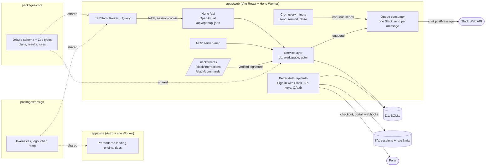

# Technical stack

**Status:** Agreed 20 November 2026. Edit in place as decisions change. Vocabulary is in [CONTEXT.md](../CONTEXT.md).

Holler copies Lymi's shape, because Lymi's shape works: everything on Cloudflare, one Worker for the product and one for the public site, shared domain code in packages. The public site at `holler.team` is an Astro site. The product at `app.holler.team` is a Vite React app and a Hono Worker that also serves the API, the Slack endpoints and the MCP server.

## Shape



## Decisions

### Hosting: two Cloudflare Workers, as in Lymi

`holler-site` serves `holler.team`: prerendered pages, the pricing page, the API and MCP docs, and `/api/health`. `holler` serves `app.holler.team`: the product SPA, `/api/*`, `/api/auth/*`, `/slack/*`, `/mcp` and OAuth discovery. Static assets fall back to the SPA only after the Worker has routed everything else, so a product path can never render a public page and the other way round.

Alternative considered: one Worker for both. Lymi split them so the site can deploy without touching auth, and the same reason holds here.

### Product UI: Vite, React 19, TanStack Router and Query, Tailwind v4, Base UI

The product is a client-rendered app. TanStack Router gives typed, file-based routes; TanStack Query owns every read and every cache. Tailwind v4 reads the Holler tokens from `packages/design/tokens.css`. Interactive primitives (dialog, menu, popover, combobox, tabs) come from `@base-ui/react`, wrapped once in `apps/web/src/client/components/ui` and styled with Holler tokens. Icons are Lucide, at 2 px stroke with round caps, which matches the brand's line icons.

The primitives in `components/ui` (field, inputs, select, combobox, dropdown menu, dialog, drawer, popover, tooltip, toast) are ported from Lymi, which has the same author, and restyled with Holler's tokens. They keep Lymi's behaviour: a sheet on touch devices, a centred overlay on the desktop, and the highlight that glides between options.

Holler has no PWA and no service worker. The web app is a place senders visit for two minutes; Slack is where the product lives day to day.

### Type: self-hosted Geologica

Both apps bundle `@fontsource-variable/geologica`, Latin and Cyrillic, behind `unicode-range`. The weight ladder is the brand's: 300 body, 400 titles and numbers, 500 buttons, 600 the wordmark. Nothing is 700. Text sizes are rem; spacing and radii are px.

### Server: Hono on the product Worker, with a service layer

`routes/*` parse input with a Zod schema from `packages/core`, describe themselves for OpenAPI, call one service and return. `services/*` hold the logic and own the database. Every service function takes a `ServiceContext`: the database, the workspace, the actor (a member through the web, Slack, an API key or a connected app, or the system) and the clock. Every write goes through `services/audit.ts`, which feeds Activity.

The web app, the REST API, Slack handlers and MCP tools are thin callers of the same services, so a rule kept in one door is kept in all of them.

### Data: D1 with Drizzle

One D1 database. Every top-level product table carries `workspace_id`. The tables that hang off a Holler (`questions`, `options`, `recipients`, `viewers`, `responses` and `answers`) do not: they are scoped through `holler_id`, so a service reaches them only after it has loaded the Holler filtered by the context's workspace. The schema is in `packages/core/src/schema`, migrations are generated by `drizzle-kit` into `apps/web/migrations`, and an applied migration never changes (`pnpm check:migrations`). The whole data model is in [data-model.md](data-model.md).

`drizzle-orm` is a dependency of `packages/core` only and is re-exported as `@holler/core/db`, so Better Auth's Kysely and the app see one copy of Drizzle's types.

### Auth: Better Auth with Sign in with Slack

Members sign in with Slack and nothing else. Better Auth's Slack provider runs Slack's OpenID Connect flow; the ID token carries the Slack team id, which picks the workspace. Recipients never sign in.

Installing Holler into a workspace is a separate OAuth flow, "Add to Slack", that grants the bot scopes and stores the bot token. The two flows can run back to back on first install: add to Slack, then sign in. Bot tokens are encrypted at rest with AES-GCM under `SLACK_TOKEN_KEY`, a Worker secret.

| Caller                             | Credential               | Better Auth piece      |
| ---------------------------------- | ------------------------ | ---------------------- |
| The web app                        | Session cookie           | core, Slack provider   |
| curl, scripts, Zapier              | API key made in Settings | `@better-auth/api-key` |
| Claude, ChatGPT, other MCP clients | OAuth 2.1 access token   | `@better-auth/mcp`     |

Keys and OAuth grants carry one scope, `read` or `write`. A key acts as the member who made it, in that member's workspace.

Local development and tests sign in through `/api/dev/sign-in?as=<persona>`, which exists only when `DEV_ROUTES=true`. Never type a Slack password into a test.

### Slack: one app, signatures checked in the Worker

Holler is one Slack app distributed through OAuth. The Worker checks Slack's request signature on every `/slack/*` request with `SLACK_SIGNING_SECRET` before reading the body, and acknowledges within three seconds; slow work runs in `waitUntil` or on the queue. Retries are deduplicated by Slack's event id in `slack_deliveries`. The design of every Slack surface is in [slack.md](slack.md).

### Sending: a Cloudflare Queue for every Slack message

Sending a Holler to 300 people is 300 DMs, and Slack rate-limits `chat.postMessage` per workspace. The service that sends a Holler writes the recipients and enqueues one message per recipient on `SLACK_SENDS`. The queue consumer posts them with retries and backoff, and honours Slack's `Retry-After`. Reminders and close notices go through the same queue. A recipient's row records what was sent, so a retry never sends twice.

Alternative considered: Tally's approach, sending five at a time inside the cron. It works for one workspace of 300 people and stops working when many workspaces send at 09:00 on Monday.

### Scheduling: one cron every minute

The cron trigger runs every minute and does four passes, each claiming its rows atomically so overlapping runs never double up: send scheduled hollers, send per-time-zone deliveries that came due, send reminders that came due, and close hollers past their close time. Each pass only enqueues; the queue does the Slack calls.

### Billing: Polar, as merchant of record

Polar sells the subscription and files VAT and sales tax as merchant of record, which suits an Estonian OÜ selling to teams worldwide. `@polar-sh/better-auth` adds checkout, the customer portal and webhooks to the auth server, keyed by the workspace. The plan lives on the workspace row; the Polar webhook is the only thing that changes it. Plan limits live in `packages/core/src/plans.ts`, so the web app shows the same limit the server enforces.

Alternatives considered: Paddle, which is the flattest fee at scale but needs more hand-written integration; Stripe Managed Payments, the dearest once Billing fees stack up; Stripe alone, which leaves VAT filing to us. Billing sits behind `services/billing.ts`, so a later switch to Paddle is one module and one webhook. [billing.md](billing.md) has the Polar setup and how a plan changes.

### API: REST with generated docs

The public API is REST under `/api/v1`, described from the Zod schemas with `hono-openapi` and served at `/api/openapi.json`. The site renders the reference. Creating a Holler through the API takes an `Idempotency-Key` header, so a retried call never sends twice.

### MCP: stateless server in the product Worker

`/mcp` is a stateless Streamable HTTP MCP server. Its tools call the same services as the REST routes: list, get, create, send, close hollers; read results; send a reminder; export. Authorization is the Better Auth OAuth server. An anonymous Holler's results follow the same five-response gate everywhere.

### Exports: built on request

A Holler's results are small enough to build in the request: CSV for spreadsheets, Markdown for docs, and a share link to a report page. CSV cells that start with `=`, `+`, `-`, `@`, tab or carriage return get a leading `'` so a spreadsheet never runs them. If exports grow past a few megabytes, they move to a Workflow and R2 as in Lymi.

### Repo: pnpm workspace

```
holler/
  apps/site         Public deployable: Astro site + health Worker
  apps/web          Product deployable: Vite React app + Hono Worker
    src/client      Routes, components, styles
    src/server      Hono app, auth, API, Slack, MCP, services, cron, queue
    migrations      Drizzle-generated SQL for D1
  packages/core     Drizzle schema, Zod types, plans, results maths, ids
  packages/design   tokens.css (source of DESIGN.md's colours), logo, chart ramp
  e2e               Playwright journeys with axe
  scripts           Repo checks
  docs              This file, the data model, Slack, testing, git workflow
```

### Interface text: English only, for now

The English sentence in the component is the message. There is no translation catalog yet. Slack messages are English too. When a second language comes, Lingui goes in the way Lymi did it, and the rule "never build a sentence from fragments" holds now so that day is a catalog and not a refactor.

### Tooling

TypeScript strict. Oxlint for lint, with Holler's own rules in `oxlint-plugin-holler`, and oxfmt for format; [ADR 0001](adr/0001-oxlint-and-oxfmt-replace-biome.md) has why Biome lost. Vitest for packages and Worker services, against a real local D1. Playwright for browser journeys in Chromium and WebKit, with `@axe-core/playwright` on every journey. GitHub Actions runs `pnpm verify` and the browser journeys on every pull request. GitHub Actions deploys `main` and a preview of every pull request; [operations.md](operations.md). Alternative considered: Cloudflare Workers Builds. Its build settings live in the dashboard, where an agent cannot read or change them, and ordering migrations before the upload would need a custom deploy command anyway.

## Decided

- Sign-in: Sign in with Slack only. Recipients never sign in. (20 November 2026)
- Billing: Polar as merchant of record, on the Estonian OÜ. (20 November 2026)
- Licence: source-available, all rights reserved. The repo is public to read, nothing more. (20 November 2026)
- Microsoft Teams: not in the first version.
- Domains: `holler.team` for the site, `app.holler.team` for the product. Not bought yet.
- Free plan: a few hollers a month per workspace, counted at send. The exact number and the Team price are open; they are constants in `packages/core/src/plans.ts`.
